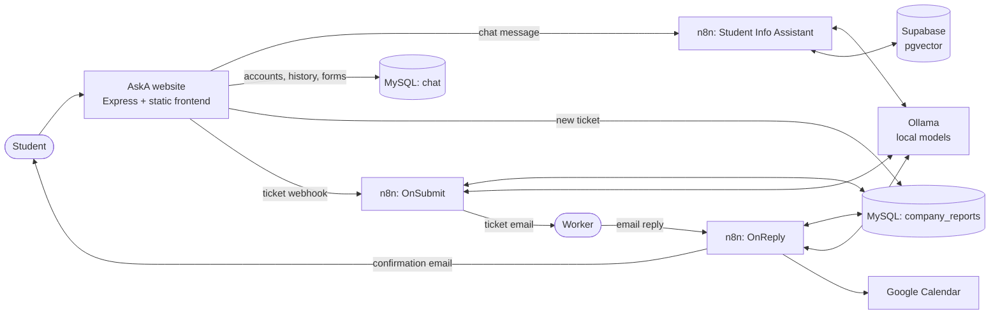

# AskA — Student Assistant

> [!NOTE]
> **For reference only.** This project was built as a proposal for a university assignment, using Xiamen University Malaysia as its example, so the prompts and departments are specific to that school. It isn't an official university service, and no n8n instance is hosted for it, so the chat and ticket automation won't work until you set up your own. The university's documents aren't included. You need to supply your own knowledge base.

AskA is a student support website for Xiamen University Malaysia (XMUM). Students can ask an AI assistant about the university, or submit a support ticket to a department. Automated workflows then find a staff member for the ticket, schedule the job and keep the student informed.

All the AI models run locally through [Ollama](https://ollama.com/), and [n8n](https://n8n.io/) handles the automation.

## Features

**For students**

- Chat with an AI assistant that answers from university documents, and says it doesn't know when the answer isn't in them
- Submit tickets to 8 departments, with categories and an optional file attachment
- Register, log in and return to saved chat history

**For staff**

- Get new tickets by email, matched to your department
- Claim a job by replying to the email with a start time
- Have accepted jobs added to Google Calendar automatically

**Behind the scenes**

- Estimates how long each job will take
- Gives each ticket to the fastest valid reply, and rejects replies that clash with the worker's schedule
- Emails pending tickets out again once a day until someone claims them

## How it works



### The n8n workflows

| Workflow | Runs when | What it does |
| --- | --- | --- |
| **Student Info Assistant** | A chat message arrives by webhook | Searches the Supabase vector store and answers from what it finds. A separate manual trigger loads the source PDF from Google Drive into the vector store. |
| **OnSubmit** | A ticket is submitted, and daily at 09:00 | Estimates the job duration, then emails the ticket to active workers in the matching department. The daily run picks up tickets not sent in the last 24 hours. |
| **OnReply** | Gmail is polled every 4 minutes for unread `Re: [TICKET #…]` emails | Extracts the proposed start time from each reply and checks it for clashes. The fastest valid reply wins: the ticket is assigned, a calendar event is created, and the worker and student are emailed. Other repliers are told why they weren't assigned. |

### Ticket lifecycle

1. A student submits the form. The ticket is saved with the status `PENDING`.
2. OnSubmit estimates the duration and emails the department's active workers.
3. Workers reply to the email with the time they can start.
4. OnReply assigns the ticket to the winning worker and sets its status to `ASSIGNED`.

The `RESOLVED` status exists in the database, but no workflow sets it yet.

## Tech stack

| Layer | Technology |
| --- | --- |
| Frontend | HTML, JavaScript, Tailwind CSS (CDN), Marked |
| Backend | Node.js, Express 5, JWT, bcrypt, Multer |
| Databases | MySQL (app data), Supabase with pgvector (document embeddings) |
| Automation | n8n, with Gmail, Google Calendar and Google Drive |
| AI | Ollama: `ministral-3:3b` (chat), `qwen3:8b` (duration estimates, reply parsing), `nomic-embed-text` (embeddings) |

## Project structure

```text
.
├── AskA Website/            # Website and API
│   ├── server.js            # Express server: auth, chat history, ticket forms
│   ├── app.js               # Frontend logic
│   ├── index.html           # Single-page UI
│   ├── style.css
│   ├── config.js            # n8n webhook URLs used by the browser
│   ├── chatDb.js            # MySQL pool for the chat database
│   ├── departmentDB.js      # MySQL pool for the company_reports database
│   ├── database.js          # Older SQLite setup, not used by the server
│   └── README.md            # Full setup guide
└── n8n_workflows/           # Workflows to import into n8n
    ├── Student Info Assistant.json
    ├── OnSubmit.json
    └── OnReply.json
```

## Getting started

The **[full setup guide](AskA%20Website/README.md)** has the SQL scripts, credential steps and n8n configuration. In outline:

**You will need:** Node.js 18 or later, MySQL, n8n, Ollama, a Supabase project, and a Google Cloud project with the Drive, Gmail and Calendar APIs enabled.

1. **Create the databases.** Create the `chat` and `company_reports` MySQL databases and their tables.

2. **Pull the models.**

   ```bash
   ollama pull nomic-embed-text:latest
   ```

   ```bash
   ollama pull ministral-3:3b
   ```

   ```bash
   ollama pull qwen3:8b
   ```

3. **Set up n8n.** Import the three files from `n8n_workflows/`, add your credentials, and create the Supabase `documents` table. In **OnReply**, select your own calendar in the `Create an event1` node.

4. **Load the knowledge base.** Upload your source PDF to Google Drive and set its ID in the `Download file` node. Then run the manual trigger in **Student Info Assistant** once. No document is included in this repository, so you need to supply your own.

5. **Publish all three workflows,** then copy their production webhook URLs into `config.js` and `server.js`.

6. **Add your workers.** Replace the placeholder rows in the `workers` table with real addresses. The sample data only covers IT, and a worker's `department` must exactly match the name used in the ticket form, or they won't receive those tickets.

7. **Configure the website.** Create `AskA Website/.env`:

   ```env
   MYSQL_HOST=localhost
   MYSQL_PORT=3306
   MYSQL_USER=root
   MYSQL_PASSWORD=
   MYSQL_DATABASE=company_reports
   JWT_SECRET=
   ```

   Set `JWT_SECRET` to a long random value. The server won't start without it. To generate one:

   ```bash
   node -e "console.log(require('crypto').randomBytes(32).toString('hex'))"
   ```

8. **Start the server.**

   ```bash
   cd "AskA Website" && npm install && node server.js
   ```

   Then open <http://localhost:3000>. Set `PORT` to use a different port.

## API

All routes except register and login need an `Authorization: Bearer <token>` header. Tokens last 24 hours.

| Method | Route | Purpose |
| --- | --- | --- |
| `POST` | `/api/register` | Create an account |
| `POST` | `/api/login` | Log in and get a token |
| `GET` | `/api/history` | List your chat sessions |
| `POST` | `/api/history` | Create a chat session |
| `PUT` | `/api/history/:id` | Update a session's title or messages |
| `DELETE` | `/api/history/:id` | Delete a session |
| `POST` | `/api/forms` | Submit a ticket (multipart form, optional `attachment` file) |

## Known limitations

This is a local development project and isn't ready for production as it stands.

**Security**

- `server.js` serves its whole directory as static files, so the backend source can be downloaded from the running site.
- Uploaded attachments can be read through `/uploads` without logging in.
- The n8n chat webhook is called directly from the browser, with no authentication.

**Behaviour**

- The chat assistant only receives the latest message, so it has no memory of earlier messages in a conversation.
- The browser also posts each ticket form to `N8N_TICKET_WEBHOOK_URL`, as well as the server calling OnSubmit. In `config.js` that URL points to the chat workflow.
- Webhook URLs are hardcoded in `config.js` and `server.js` instead of being set through the environment.
